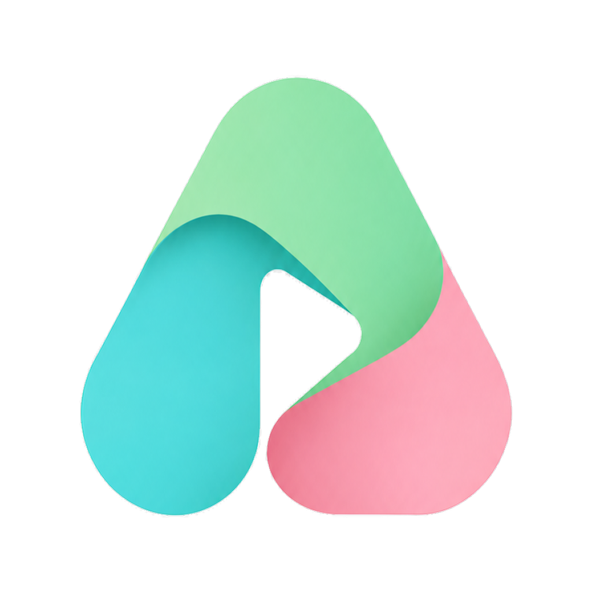
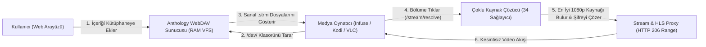

<div align="center">
  
  <h1>Anthology WebDAV</h1>
  <p><strong>Sıfır Disk Alanı Harcayan, Akıllı Kütüphane ve Çoklu Kaynak Çözücü Destekli Sanal WebDAV Medya Sunucusu</strong></p>

  <p>
    
    
    
    
  </p>
</div>

---

## 📖 İçindekiler

1. [Bu Proje Ne İçin Yapıldı? (Vizyon ve Amaç)](#-1-bu-proje-ne-için-yapıldı-vizyon-ve-amaç)
2. [WebDAV Nedir ve Anthology WebDAV Nasıl Çalışır?](#-2-webdav-nedir-ve-anthology-webdav-nasıl-çalışır)
3. [Hangi Cihazlarda ve Hangi Uygulamalarla Kullanılabilir?](#-3-hangi-cihazlarda-ve-hangi-uygulamalarla-kullanılabilir)
4. [Kurulum, Başlangıçta Otomatik Açılma ve İzinlerin Verilmesi](#-4-kurulum-başlangıçta-otomatik-açılma-ve-izinlerin-verilmesi)
5. [Ev Ağındaki (LAN) Diğer Cihazlardan (TV, Telefon, Tablet) Bağlanma](#-5-ev-ağındaki-lan-diğer-cihazlardan-tv-telefon-tablet-bağlanma)
6. [Web Arayüzünün (`Anthology WebDAV`) Kullanımı](#-6-web-arayüzünün-anthology-webdav-kullanımı)
7. [Dosyalara Nereden Ulaşılır? (Sanal Klasör Haritası ve Disk Yapısı)](#-7-dosyalara-nereden-ulaşılır-sanal-klasör-haritası-ve-disk-yapısı)
8. [Uygulama Bazlı Bağlantı Rehberleri (Infuse, Kodi, Nova, VidHub, VLC, IINA, Finder/Explorer)](#-8-uygulama-bazlı-bağlantı-rehberleri)
9. [Metadata, Posterler ve Videolar Neden Bazen Geç Yüklenir? (Nasıl Hızlandırılır?)](#-9-metadata-posterler-ve-videolar-neden-bazen-geç-yüklenir-nasıl-hızlandırılır)
10. [Bölümleri ve Filmleri Cihaza Nasıl İndirirsiniz? (Çevrimdışı İzleme Rehberi)](#-10-bölümleri-ve-filmleri-cihaza-nasıl-indirirsiniz-çevrimdışı-izleme-rehberi)
11. [Kullanım Kolaylığı İçin Kısayollar, Uygulama Modu ve Pratik İpuçları](#-11-kullanım-kolaylığı-için-kısayollar-uygulama-modu-ve-pratik-ipuçları)
12. [Kayıtlı 34 Sağlayıcı Motoru](#-12-kayıtlı-34-sağlayıcı-motoru)
13. [Sorun Giderme (Troubleshooting) ve Sıkça Sorulan Sorular (SSS)](#-13-sorun-giderme-troubleshooting-ve-sıkça-sorulan-sorular-sss)

---

## 🎯 1. Bu Proje Ne İçin Yapıldı? (Vizyon ve Amaç)

İnternet üzerinden Türkçe dublaj veya altyazılı bir film, yabancı dizi, yerli dizi veya anime izlemek istediğinizde genellikle şu sorunlarla karşılaşırsınız:
- Tarayıcıda açılan onlarca reklam penceresi, sahte "Oynat" butonları ve düşük kaliteli web oynatıcıları,
- Bir sitenin kapanması veya videonun silinmesi yüzünden başka sitelerde tek tek bölüm arama zahmeti,
- Videoları bilgisayarınıza veya telefonunuza indirmeye kalktığınızda yüzlerce gigabaytlık disk alanının dolması,
- Televizyonda (Apple TV, Android TV) veya mobil cihazlarda tarayıcı üzerinden video açmanın neredeyse imkânsız olması.

**Anthology WebDAV**, tüm bu sorunları kökten çözmek için geliştirilmiş **sıfır disk alanı harcayan (Zero-Disk / In-Memory)** yerel bir medya sunucusu ve akıllı yayın çözücüsüdür:

1. **Sıfır Disk Alanı Tüketimi:** Bilgisayarınızın SSD/HDD'sine **tek bir megabayt bile video indirmez**. Tüm klasörler ve dosyalar sanal olarak RAM üzerinde üretilir.
2. **34 Kaynak Tek Merkezde:** Türkiye'nin en popüler **8 anime, 12 dizi ve 14 film** kaynağını tek bir Go mikroservisi içinde birleştirir.
3. **Sıfır Karmaşa (Akıllı Kütüphane):** Binlerce izlemeyeceğiniz filmin klasörleriyle medya oynatıcınızı çöplüğe çevirmez. Web arayüzünden sadece izlemek istediğiniz filmi, diziyi veya animeyi aratıp **"+ Kütüphaneme Ekle"** dersiniz; o içeriğin tüm sezon ve bölümleri saniyesinde medya oynatıcınıza hazır düşer.
4. **En Üst Düzey Oynatıcı Deneyimi:** Tarayıcıların hantal video oynatıcıları yerine videoları doğrudan **Infuse, Kodi, IINA, VLC, VidHub, Nova Video Player** gibi profesyonel medya oynatıcılarında; donanım hızlandırmalı, 1080p/4K kalitesinde, reklamsız ve tam ekran olarak izlemenizi sağlar.
5. **%100 Otomatik Poster ve Konu Özeti (Metadata):** Klasör ve dosya isimleri uluslararası medya standartlarında (`{Başlık} ({Yıl})/Season 01/{Başlık} - S01E01.strm`) üretildiği için medya oynatıcınız afişleri, arka plan görsellerini, IMDb puanlarını, oyuncu kadrosunu ve Türkçe bölüm özetlerini otomatik olarak bulup eşleştirir.

---

## 🧠 2. WebDAV Nedir ve Anthology WebDAV Nasıl Çalışır?

### WebDAV Nedir?
**WebDAV** (*Web Distributed Authoring and Versioning*), standart HTTP protokolünün bir uzantısıdır. En basit anlatımıyla: **Bir web sunucusunu bilgisayarınıza, telefonunuza veya televizyonunuza sanki fiziksel bir harici sabit disk veya USB bellek takmışsınız gibi bağlamanızı sağlayan teknolojidir.**

Medya oynatıcılar (Infuse, Kodi, VLC vb.) ve işletim sistemleri (macOS Finder, Windows Dosya Gezgini, iOS Dosyalar) WebDAV adresine bağlandığında karşısında gerçek klasörler ve dosyalar görür.

### Anthology WebDAV Arka Planda Nasıl Çalışır?



1. **Sanal Dosya Sistemi (Virtual File System - VFS):**
   Siz kütüphanenize örneğin *Breaking Bad* dizisini eklediğinizde, sunucu diskinize video indirmez. Bunun yerine `/dav/Diziler/Breaking Bad (2008)/Season 01/Breaking Bad - S01E01.strm` şeklinde sanal bir dosya ağacı oluşturur.
2. **`.strm` (Stream) Dosyası Nedir?**
   `.strm` dosyaları tüm modern medya oynatıcıların tanıdığı, boyutu sadece ~120 byte olan özel metin dosyalarıdır. İçinde videonun kendisi değil, Anthology WebDAV sunucusunun akıllı çözümleyici adresi yer alır:
   `http://127.0.0.1:8085/stream/resolve?type=series&tmdb_id=1396&title=Breaking+Bad&season=1&episode=1`
3. **Eşzamanlı Çoklu Sağlayıcı Çözücü (Multi-Provider Scraper):**
   Medya oynatıcınızda bölüme tıkladığınız anda sunucu uyanır ve o kategorideki tüm sağlayıcıları (örneğin bir dizi için aynı anda *DiziWatch, DiziBox, DiziMom, DiziYou, DiziBak, YabancıDizi...*) paralel olarak tarar.
4. **En İyi Kalite Seçimi ve Korumalı Akış Köprüsü (Stream Proxy):**
   Bulunan kaynaklar arasından **1080p > 720p > 480p** önceliğine göre en kaliteli akış seçilir. Eğer video sunucusu özel güvenlik başlıkları (`Referer`, `Origin`, `User-Agent`, `XOR Token`) istiyorsa, Anthology WebDAV araya girerek videoyu kendi üzerinden köprüler (Proxy). Böylece ileri-geri sarma (`HTTP 206 Partial Content / Range`) ve HLS (`.m3u8`) oynatma kusursuz çalışır.

---

## 📱 3. Hangi Cihazlarda ve Hangi Uygulamalarla Kullanılabilir?

Anthology WebDAV standart protokoller kullandığı için **sadece tek bir işletim sistemine veya tek bir programa bağımlı değildir.** Ev ağınızdaki veya bilgisayarınızdaki hemen her cihazda çalışır:

| Platform / Cihaz | Tavsiye Edilen En İyi Uygulamalar | Nasıl Bağlanır? | Özellik Desteği |
| :--- | :--- | :--- | :--- |
| **macOS** (MacBook, iMac, Mac mini/Studio) | **Infuse**, **VidHub**, **IINA**, **VLC**, **Kodi**, **SenPlayer**, **Finder** | Doğrudan WebDAV (`127.0.0.1:8085/dav`) veya Finder'a disk olarak bağlayarak | Poster, Özet, 4K/1080p, İleri/Geri Sarma, Kütüphaneden Silme |
| **iOS & iPadOS** (iPhone, iPad) | **Infuse**, **VidHub**, **SenPlayer**, **Fileball**, **VLC**, **Dosyalar (Files)** | Yerel ağ IP'si ile WebDAV (`192.168.1.X:8085/dav`) | Otomatik Poster, Altyazı, AirPlay, PiP (Resim İçinde Resim) |
| **tvOS** (Apple TV 4K / HD) | **Infuse**, **VidHub**, **SenPlayer**, **Fileball**, **VLC** | Yerel ağ IP'si ile WebDAV (`192.168.1.X:8085/dav`) | Kumanda ile Tam Ev Sineması, Dolby / Uzamsal Ses, iCloud Senkronu |
| **Windows 10 / 11** | **Kodi**, **PotPlayer**, **VLC**, **MPC-HC/BE**, **RaiDrive**, **Dosya Gezgini** | Kodi WebDAV kaynağı veya Windows'a Ağ Sürücüsü (`Z:\`) olarak bağlayarak | Tam Ekran Medya Merkezi, `.strm` Oynatma, M3U/HLS Akışı |
| **Android TV / Google TV / Mi Box / Fire TV** | **Kodi**, **Nova Video Player**, **VLC for Android**, **Cx Dosya Gezgini** | Yerel ağ IP'si ile WebDAV (`192.168.1.X:8085/dav`) | Kumanda Dostu Arayüz, Otomatik Film/Dizi Afişleri (Kodi & Nova) |
| **Android Telefon & Tablet** | **Nova Video Player**, **Kodi**, **VLC**, **MX Player**, **Solid Explorer** | Yerel ağ IP'si ile WebDAV (`192.168.1.X:8085/dav`) | Mobil İzleme, Altyazı Seçimi, Donanım Çözücü |
| **Linux** (Ubuntu, Arch, Fedora, Steam Deck) | **Kodi**, **MPV**, **VLC**, **GNOME Files (Nautilus)**, **KDE Dolphin** | `dav://127.0.0.1:8085/dav` veya `rclone mount` | Doğrudan Dosya Yöneticisi Entegrasyonu ve Hafif Oynatma |

---

## 🛠️ 4. Kurulum, Başlangıçta Otomatik Açılma ve İzinlerin Verilmesi

### A. Ön Gereksinimler
Projeyi derlemek için sisteminizde **Go (1.24 veya üzeri)** kurulu olmalıdır.

- **macOS (Homebrew ile):**
  ```bash
  brew install go git
  ```
- **Windows (Winget ile):**
  ```powershell
  winget install GoLang.Go Git.Git
  ```
- **Linux (Ubuntu/Debian):**
  ```bash
  sudo apt update && sudo apt install -y golang git make
  ```

### B. Projeyi İndirme ve Derleme

```bash
git clone https://github.com/falsisdev/anthology-dav.git
cd anthology-dav
make build
```
*(Alternatif olarak `make` kullanmadan doğrudan `go build -o anthology-dav .` komutuyla da derleyebilirsiniz.)*

### C. Gerekli Tüm İzinlerin Verilmesi (Çok Önemli!)

Sunucunun kesintisiz çalışması, başlangıçta takılmaması ve ev ağınızdaki diğer cihazların (TV, telefon) erişebilmesi için aşağıdaki izinleri sırasıyla verin:

#### 1. Çalıştırma ve Karantina İzninin Verilmesi (macOS / Linux)
Derlenen ikili dosyanın işletim sistemi tarafından engellenmemesi için:
```bash
chmod +x anthology-dav
# macOS Gatekeeper karantina bayrağını temizlemek için:
xattr -cr anthology-dav 2>/dev/null || true
```

#### 2. Güvenlik Duvarı (Firewall) ve Yerel Ağ İzni
- **macOS:** Sunucuyu ilk çalıştırdığınızda ekrana *"anthology-dav gelen ağ bağlantılarını kabul etsin mi?"* uyarısı gelirse mutlaka **"İzin Ver" (Allow)** seçeneğine tıklayın.
  - Manuel kontrol için: **Sistem Ayarları -> Ağ -> Güvenlik Duvarı -> Seçenekler** menüsünden `anthology-dav` uygulamasının **"Gelen bağlantıları kabul et"** olarak ayarlandığından emin olun.
  - Eğer **Sistem Ayarları -> Gizlilik ve Güvenlik -> Yerel Ağ (Local Network)** altında kullandığınız terminal uygulaması (Terminal / iTerm2) veya `anthology-dav` görünüyorsa anahtarın açık olduğundan emin olun.
- **Windows:** İlk çalıştırmada Windows Defender Güvenlik Duvarı penceresi açıldığında **"Özel ağlar (Ev/İş ağları)"** kutucuğunu işaretleyip **"Erişime izin ver"** butonuna tıklayın.

#### 3. Klasör ve Dosya Yazma İzinleri
Sunucu, eklediğiniz içerikleri `library.json` dosyasına, arama geçmişinizi ise `watchlist.json` dosyasına kaydeder. Proje klasöründe yazma izniniz olduğundan emin olun:
```bash
touch library.json watchlist.json
chmod 644 library.json watchlist.json
```

---

### D. Bilgisayar Açıldığında Otomatik Başlama (Arka Plan Servisi)

Her seferinde terminal açıp komut yazmak yerine, bilgisayarınız açıldığında `anthology-dav`'ın arka planda sessizce (0 pencere ile) başlamasını sağlayabilirsiniz:

#### 🍎 1. macOS'ta Otomatik Başlatma (`LaunchAgent`)
Proje içinde hazır bir servis kurulum komutu yer alır:
```bash
make install-service
```
> [!NOTE]
> `make install-service` komutu projenin bulunduğu dizini otomatik olarak tespit eder ve LaunchAgent plist dosyasını dinamik olarak yapılandırır. Herhangi bir dosya yolunu elle düzenlemenize gerek yoktur.

**Servis Yönetim Komutları (macOS):**
- **Servisi Kur ve Başlat:** `make install-service`
- **Canlı Logları (Kayıtları) İzle:** `make logs`
- **Servisi Durdur ve Kaldır:** `make uninstall-service`
- **Servisi Yeniden Başlat:**
  ```bash
  launchctl unload ~/Library/LaunchAgents/com.falsisdev.anthology-dav.plist
  launchctl load -w ~/Library/LaunchAgents/com.falsisdev.anthology-dav.plist
  ```

#### 🐧 2. Linux'ta Otomatik Başlatma (`systemd`)
1. Kullanıcı servis dizinini oluşturun:
   ```bash
   mkdir -p ~/.config/systemd/user
   ```
2. `~/.config/systemd/user/anthology-dav.service` dosyasını oluşturun:
   ```ini
   [Unit]
   Description=Anthology WebDAV Media Server
   After=network-online.target

   [Service]
   WorkingDirectory=/tam/dosya/yolu/anthology-dav
   ExecStart=/tam/dosya/yolu/anthology-dav/anthology-dav -host 0.0.0.0 -port 8085
   Restart=always
   RestartSec=5

   [Install]
   WantedBy=default.target
   ```
3. Servisi etkinleştirin:
   ```bash
   systemctl --user daemon-reload
   systemctl --user enable --now anthology-dav.service
   ```

#### 🪟 3. Windows'ta Otomatik Başlatma
1. `go build -o anthology-dav.exe .` komutuyla `.exe` dosyasını oluşturun.
2. `Win + R` tuşlarına basıp `shell:startup` yazarak **Başlangıç** klasörünü açın.
3. Klasörün içine `baslat.vbs` adında bir dosya oluşturup içine şunu yazın (böylece siyah komut penceresi görünmeden arka planda çalışır):
   ```vbscript
   Set WshShell = CreateObject("WScript.Shell")
   WshShell.CurrentDirectory = "C:\anthology-dav"
   WshShell.Run "C:\anthology-dav\anthology-dav.exe -host 0.0.0.0 -port 8085", 0, False
   ```

---

## 🌐 5. Ev Ağındaki (LAN) Diğer Cihazlardan (TV, Telefon, Tablet) Bağlanma

Varsayılan olarak sunucu sadece kendi bilgisayarınızdan erişim için `127.0.0.1` (localhost) üzerinde başlar. Ancak sunucuyu **Apple TV, Android TV, iPhone, iPad veya evdeki başka bir bilgisayardan** kullanmak istiyorsanız:

1. **Sunucuyu Tüm Ağ Kartlarını Dinleyecek Şekilde (`0.0.0.0`) Başlatın:**
   ```bash
   ./anthology-dav -host 0.0.0.0 -port 8085
   ```
   *(Arka plan servisi kullanıyorsanız `scripts/com.falsisdev.anthology-dav.plist` içindeki `127.0.0.1` değerini bilgisayarınızın yerel IP adresi veya `0.0.0.0` ile değiştirebilirsiniz.)*

2. **Bilgisayarınızın Yerel IP Adresini Öğrenin:**
   - **macOS:** Terminal'e `ipconfig getifaddr en0` yazın (Örn: `192.168.1.45`).
   - **Windows:** Komut İstemi'ne `ipconfig` yazıp **IPv4 Address** satırına bakın.
   - **Linux:** `hostname -I` yazın.

3. **Diğer Cihazlardan Erişin:**
   - Telefon veya TV'nizdeki medya oynatıcıya WebDAV adresi olarak `127.0.0.1` yerine bilgisayarınızın yerel IP adresini (`192.168.1.45`) girin!
   - Hatta telefonunuzun tarayıcısından `http://192.168.1.45:8085/` adresine girerek koltuğunuzdan kalkmadan televizyonda izleyeceğiniz filmi kütüphanenize ekleyebilirsiniz!

---

## 🖥️ 6. Web Arayüzünün (`Anthology WebDAV`) Kullanımı

Sunucu çalışırken tarayıcınızdan **[http://localhost:8085/](http://localhost:8085/)** adresini açın. Karşınıza modern, hızlı ve sade **Anthology WebDAV** yönetim arayüzü çıkacaktır.

Arayüzün üst barında **3 ana sekme** bulunur:

### 🔍 1. Keşfet & Ara Sekmesi
- Ortadaki geniş arama çubuğuna izlemek istediğiniz herhangi bir **film, dizi veya anime** adını yazın (Türkçe veya orijinal İngilizce/Japonca adıyla aratabilirsiniz).
- Siz yazarken **300ms** içinde sonuçlar posterleri, yayın yılları, IMDb/TMDB puanları ve tür etiketleriyle (`🎬 FILM`, `📺 DIZI`, `⛩️ ANIME`) listelenir.
- **Akıllı Anime Algılama:** Sistem, Japon animasyonlarını normal dizilerden otomatik olarak ayırır ve `⛩️ ANIME` etiketiyle işaretler.
- İzlemek istediğiniz içeriğin altındaki **"+ Kütüphaneme Ekle"** butonuna tıklayın. Buton anında yeşile dönerek **"✓ Kütüphanede"** olur ve içerik WebDAV sunucunuza eklenir!

### 📚 2. Kütüphanem Sekmesi
- Eklediğiniz tüm içerikleri tek bir ekranda görebilir, sağ üstteki filtre haplarıyla (**Tümü**, **🎬 Filmler**, **📺 Diziler**, **⛩️ Animeler**) süzebilirsiniz.
- **Kaynak Seçici (Provider Selector) & Çalışan Kaynakları Bul:** Her içeriğin kartında bir açılır menü ve **"🔍 Çalışan Kaynakları Bul"** butonu bulunur:
  - **`Otomatik (En İyi Çalışan Kaynak)` (Varsayılan & Tavsiye Edilen):** Videoyu açtığınızda tüm uygun sağlayıcıları aynı anda tarar ve en yüksek kaliteli çalışan yayını otomatik seçer.
  - **Belirli Bir Sağlayıcıya Sabitleme:** Örneğin bir animenin sadece *AnimeciX* veya *Anizium* çevirisiyle, ya da bir filmin sadece *FilmModu* kaynağıyla açılmasını istiyorsanız menüden o sağlayıcıyı seçebilirsiniz. Tercihiniz anında kaydedilir.
- **Kütüphaneden Çıkar:** İzlemeyi bitirdiğiniz bir içeriği **"Kütüphaneden Çıkar"** butonuyla kaldırabilirsiniz.

### ⚙️ 3. Sağlayıcılar Sekmesi
- Sistemde aktif olan **34 sağlayıcı motorunun** tamamını, resmi logolarını, hizmet verdikleri kategoriyi (`Film`, `Dizi`, `Anime`), güncel alan adlarını ve çalışma durumlarını (`AKTİF`) görebilirsiniz.

---

## 📂 7. Dosyalara Nereden Ulaşılır? (Sanal Klasör Haritası ve Disk Yapısı)

### A. WebDAV Sanal Dizin Haritası (`http://127.0.0.1:8085/dav/`)

Medya oynatıcınızla veya dosya yöneticinizle `/dav/` adresine bağlandığınızda göreceğiniz klasör yapısı şöyledir:

```text
/dav/
├── Filmler/                                    # Kütüphanenize eklediğiniz filmler
│   └── Inception (2010)/
│       └── Inception (2010).strm               # Tıklandığında 1080p filmi çözer ve oynatır
│
├── Diziler/                                    # Kütüphanenize eklediğiniz yabancı ve yerli diziler
│   └── Breaking Bad (2008)/
│       ├── Season 01/
│       │   ├── Breaking Bad (2008) - S01E01.strm
│       │   ├── Breaking Bad (2008) - S01E02.strm
│       │   └── ...
│       └── Season 02/
│
├── Animeler/                                   # Kütüphanenize eklediğiniz animeler
│   └── Solo Leveling (2024)/
│       └── Season 01/
│           ├── Solo Leveling (2024) - S01E01.strm
│           └── ...
│
├── _Kaynak_Sec_/                               # İsteğe bağlı doğrulanmış kaynak seçici klasörü
├── Watchlist/                                  # Finder/Dosya Yöneticisi içinden yeni klasör açarak arama dizini
└── _Tum_Saglayicilar/                          # 34 sağlayıcının vitrinlerini tek tek gezmek isteyenler için arşiv
```

### B. Proje Klasöründeki Fiziksel Dosyalar
Projenin kurulu olduğu klasörde yalnızca şu küçük yapılandırma dosyaları tutulur:
- `library.json`: Kütüphanenize eklediğiniz film, dizi ve animelerin listesi (Yedeklemek isterseniz sadece bu dosyayı kopyalamanız yeterlidir!).
- `watchlist.json`: WebDAV içinden klasör oluşturarak yaptığınız aramaların kaydı.
- `/tmp/anthology-dav.log`: Sunucunun çalışma ve video çözümleme kayıtları (logları).

---

## 🎬 8. Uygulama Bazlı Bağlantı Rehberleri

### 1. Infuse (macOS, iPhone, iPad, Apple TV)
1. **Infuse** uygulamasını açın.
2. **Ayarlar (Settings) ⚙️ -> Paylaşımlar (Shares) -> Paylaşım Ekle (Add Share) -> WebDAV** seçeneğine tıklayın.
3. Bilgileri şu şekilde doldurun:
   - **Ad (Name):** `Anthology WebDAV`
   - **Protokol:** `WebDAV (HTTP)`
   - **Adres (Address):** `127.0.0.1` *(Farklı cihazdaysanız bilgisayarın yerel IP'si, örn: `192.168.1.45`)*
   - **Kullanıcı Adı / Şifre:** *(Boş bırakın)*
   - **Gelişmiş (Advanced) -> Port:** `8085`
   - **Gelişmiş (Advanced) -> Yol (Path):** `/dav`
4. **Kaydet (Save)** butonuna basın.
5. Açılan klasör listesinden **`Filmler`**, **`Diziler`** ve **`Animeler`** klasörlerinin üzerine sağ tıklayıp (veya basılı tutup) **"Favorilere Ekle" (Add to Favorites)** seçin.
   > [!TIP]
   > **`_Tum_Saglayicilar` klasörünü favorilere eklemeyin!** Böylece oynatıcınız 34 sağlayıcının binlerce vitrin içeriğini taramakla vakit kaybetmez, sadece sizin kütüphanenize eklediğiniz içerikleri saniyeler içinde indeksler.

### 2. VidHub & SenPlayer (macOS, iOS, iPadOS, Apple TV)
1. Uygulamayı açıp **File Source / Medya Kaynağı Ekle -> WebDAV** bölümüne girin.
2. Sunucu adresine `http://127.0.0.1:8085`, port kısmına `8085`, yol (path) kısmına `/dav` yazın. Kullanıcı adı ve şifreyi boş bırakıp kaydedin.
3. `Filmler`, `Diziler` ve `Animeler` klasörlerini seçerek kütüphanenizi anında posterleriyle görüntüleyin.

### 3. Kodi (Windows, Android TV, Google TV, Linux, macOS)
1. Kodi'yi açın -> **Videolar (Videos) -> Dosyalar (Files) -> Video ekle... (Add videos...)** seçeneğine tıklayın.
2. **Gözat (Browse) -> Ağ konumu ekle... (Add network location...)** seçin:
   - **Protokol:** `WebDAV sunucusu (HTTP)`
   - **Sunucu adresi:** `127.0.0.1` *(TV'deyseniz bilgisayarınızın yerel IP'si)*
   - **Uzak yol (Remote path):** `dav`
   - **Port:** `8085`
   - **Kullanıcı adı / Parola:** *(Boş bırakın)*
3. Kaynağı ekledikten sonra içerisine girip:
   - `Filmler` klasörünün üzerinde içerik menüsünü açıp **"İçeriği Değiştir" (Set Content) -> Movies (Filmler)** olarak seçin (Bilgi sağlayıcı: *The Movie Database Python*).
   - `Diziler` ve `Animeler` klasörlerini ise **TV Shows (TV Dizileri)** olarak işaretleyin. Kodi tüm posterleri ve bölüm bilgilerini otomatik çekecektir!

### 4. Nova Video Player (Android TV, Google TV, Mi Box, Android Telefon/Tablet)
1. Nova Video Player'ı açın -> Sol menüden **Ağ ve Dosyalar (Network & Files) -> Kısayol Ekle (+)** seçin.
2. Protokol olarak **WebDAV (`http://`)**, Sunucu olarak bilgisayarınızın IP adresini (`192.168.1.X`), Port olarak `8085`, Klasör (Path) olarak `/dav` girin.
3. `Filmler` ve `Diziler` klasörlerine sağ tıklayıp **"Kütüphaneye İndeksle" (Index folder)** seçeneğine basın.

### 5. VLC Media Player & IINA
- **Doğrudan Bağlantı (Ağ Akışı):** Web arayüzündeki **Çalışan Kaynakları Bul** penceresinden kopyaladığınız doğrulanmış yayın adresini VLC'de `⌘N` (`Ctrl+N`) veya IINA'da `⌘O` ("URL Aç...") penceresine yapıştırarak anında oynatabilirsiniz.
- **Finder / Dosya Gezgini Üzerinden:** WebDAV'ı işletim sisteminize disk olarak bağladığınızda (bkz. alt madde), klasör içindeki `.strm` dosyalarını doğrudan VLC veya IINA penceresine sürükleyip bırakarak oynatabilirsiniz.

### 6. İşletim Sistemine Doğrudan Disk Sürücüsü Olarak Bağlama
- **macOS Finder:**
  1. Masaüstündeyken veya Finder açıkken **`⌘K` (Command + K)** tuşlarına basın (*Git -> Sunucuya Bağlan*).
  2. Sunucu adresine `http://127.0.0.1:8085/dav/` yazıp **Bağlan**'a tıklayın.
  3. Sorulduğunda **"Konuk Olarak" (Guest)** seçeneğini işaretleyip bağlanın. Artık Finder sol menüsünde disk olarak görünecektir!
  > [!TIP]
  > **Doğrudan Dosya Yöneticisi veya Medya Oynatıcı İçinden Silme:** Finder, Dosya Gezgini veya WebDAV silme destekleyen medya oynatıcılarda (Infuse vb.) `/dav/Filmler/` veya `/dav/Diziler/` içindeki bir klasörü sildiğinizde, o içerik otomatik olarak `library.json` kütüphanenizden de kalıcı olarak silinir!
- **Windows Dosya Gezgini:**
  1. **Bu Bilgisayar (This PC)** ekranında üst menüden **Ağ Sürücüsüne Bağlan (Map Network Drive)** seçeneğine tıklayın.
  2. Klasör kutusuna `http://127.0.0.1:8085/dav` yazıp **Son** butonuna basın.

---

## ⚡ 9. Metadata, Posterler ve Videolar Neden Bazen Geç Yüklenir? (Nasıl Hızlandırılır?)

Anthology WebDAV kullanırken bazı durumlarda dizi klasörlerinin açılmasının veya bir videonun başlamasının **2 ile 5 saniye** sürdüğünü fark edebilirsiniz. Bunun arkasındaki teknik sebepler ve sistemi **en yüksek hıza çıkarma yöntemleri** şunlardır:

### 1. Sıfır Disk ve İstek Üzerine Üretim (On-Demand / Lazy Loading)
Fiziksel bir sabit diskte dosyalar önceden oluşturulmuştur. Anthology WebDAV'da ise diskinizde hiçbir dosya yoktur:
- Siz kütüphanenize 5 sezonluk bir dizi eklediğinizde, sunucu TMDB veritabanına bağlanıp sezon ve bölüm sayılarını çeker ve `library.json` içine önbellekler.
- **Önbellek (Cache) Avantajı:** Sezon/bölüm verisi doğrudan yerel önbellekten okunduğu için klasör gezinme süresi **0 milisaniyedir** (anında açılır).

### 2. Medya Oynatıcılarda "Gömülü Metadata" (Embedded Metadata) Ayarı — *Önemli Performans İpucu*
Infuse, VidHub, Kodi veya benzeri bir medya oynatıcı yeni eklenen bölümleri tararken eğer **"Gömülü Metaveri / Embedded Metadata"** ayarı açıksa, her bir `.strm` dosyasının sadece ismine bakmakla yetinmez; video dosyasının içine girip codec/çözünürlük bilgisi okumaya çalışır. Bu da oynatıcının arka planda 50 bölümün tamamını aynı anda oynatmaya çalışıp sağlayıcılara gereksiz yüzlerce istek atmasına ve taramanın çok yavaşlamasına yol açar!

> [!IMPORTANT]
> **Tüm Medya Oynatıcılar İçin Hızlandırma Ayarı (10 Kat Daha Hızlı Poster Yükleme):**
> 1. Medya oynatıcınızın ayarlarında **Metadata Getirme (Metadata Fetching / Scraper)** seçeneğini **Açık (On)** tutun (TMDB üzerinden poster ve özetlerin anında inmesi için).
> 2. Varsa **Gömülü Metadata (Embedded Metadata / Read Local Tags)** seçeneğini mutlaka **KAPALI (Off)** yapın!
> 3. **Önizleme / Küçük Resim Üretimi (Pre-Cache Details / Video Previews / Extract Thumbnails)** ayarını kapatın.
>
> *(Örneğin Infuse'da: **Ayarlar -> Genel -> Gömülü Metadata: KAPALI**)*
>
> Bu ayarı kapattığınızda oynatıcı dosyaların içine ağ isteği atmaz; doğrudan `Breaking Bad (2008) - S01E01.strm` dosya adından posteri ve Türkçe özeti **milisaniyeler içinde** çeker!

### 3. İlk Oynatma (Cold Start) vs. Önbellekli Oynatma (Warm Cache)
- Bir filme veya bölüme **ilk kez** tıkladığınızda (`Cold Start`), Anthology WebDAV arka planda 8 ila 14 farklı sağlayıcı sitesine aynı anda bağlanır, arama yapar, şifreli player kodlarını (VidMoly, CloseLoad, TauVideo, Vidrame XOR vb.) çözer ve en yüksek çözünürlüklü akışı seçer. Bu işlem kaynak sitelerin yanıt hızına göre **1.5 ile 4 saniye** sürer.
- Çözümlenen akış adresi **45 dakika boyunca RAM'e kaydedilir (`Warm Cache`)**. Videoyu kapatıp tekrar açtığınızda veya ileri-geri sardığınızda video **anında** başlar.

### 4. Kaynak Site Yavaşlığı (Sağlayıcı Sabitleme İpucu)
Eğer çoklu çözücü bir dizide yavaş yanıt veren bir sağlayıcı yüzünden 4-5 saniye bekletiyorsa, Web Arayüzündeki **Kütüphanem** sekmesinden o dizi için hızlı olduğunu bildiğiniz tek bir sağlayıcıyı (örneğin animeler için `AnimeciX` veya `Anizium`, filmler için `FilmModu` veya `HDFilmCehennemi`) seçebilirsiniz. Böylece diğer siteler beklenmez ve video çok daha hızlı açılır.

---

## 💾 10. Bölümleri ve Filmleri Cihaza Nasıl İndirirsiniz? (Çevrimdışı İzleme Rehberi)

Uçak yolculuğuna çıkacaksanız veya internetinizin olmayacağı bir yerde izlemek için bölümleri bilgisayara/telefona gerçekten **video dosyası (`.mp4` / `.mkv`)** olarak indirmek isteyebilirsiniz.

> [!WARNING]
> **Dikkat:** WebDAV klasöründeki `.strm` dosyasını masaüstüne kopyalamak videoyu **indirmez!** Çünkü `.strm` dosyası sadece 120 byte'lık bir yönlendirme adresidir. Gerçek videoyu indirmek için aşağıdaki yöntemleri kullanın:

### Yöntem 1: `yt-dlp` ile En Yüksek Hızda MP4/MKV Olarak İndirme (En Garantili Yöntem)
Hem doğrudan MP4 akışlarını hem de parçalı HLS (`.m3u8`) yayınlarını otomatik birleştirip indirmek için `yt-dlp` ve `ffmpeg` ikilisi mükemmel çalışır:

1. `yt-dlp` ve `ffmpeg` kurulu değilse kurun (`brew install yt-dlp ffmpeg` veya `winget install yt-dlp.yt-dlp Gyan.FFmpeg`).
2. Finder veya metin düzenleyici ile indirmek istediğiniz bölümün `.strm` dosyasını açıp içindeki adresi kopyalayın (Örn: `http://127.0.0.1:8085/stream/resolve?type=anime&tmdb_id=127532&title=Solo+Leveling&year=2024&season=1&episode=1`).
3. Terminalde şu komutu çalıştırın:
   ```bash
   yt-dlp "http://127.0.0.1:8085/stream/resolve?type=anime&tmdb_id=127532&title=Solo+Leveling&year=2024&season=1&episode=1" -o "Solo_Leveling_S01E01.mp4"
   ```
   `yt-dlp`, Anthology WebDAV'ın çözdüğü 1080p akışı yakalar ve saniyeler içinde tam bir `.mp4` dosyası olarak diskinize indirir!

### Yöntem 2: Tüm Sezonu Tek Komutla Toplu İndirme
Bir dizinin örneğin 1. sezonundaki ilk 12 bölümü tek seferde bilgisayara indirmek için terminalde şu döngüyü çalıştırabilirsiniz:
```bash
for ep in {1..12}; do
  yt-dlp "http://127.0.0.1:8085/stream/resolve?type=anime&tmdb_id=127532&title=Solo+Leveling&year=2024&season=1&episode=${ep}" \
    -o "Solo_Leveling_S01E$(printf %02d $ep).mp4"
done
```

### Yöntem 3: `ffmpeg` veya `curl` ile İndirme
- **HLS / M3U8 veya MP4 akışlarını `ffmpeg` ile kaydetmek için:**
  ```bash
  ffmpeg -i "http://127.0.0.1:8085/stream/resolve?type=movie&tmdb_id=27205&title=Inception&year=2010" -c copy "Inception_2010.mp4"
  ```
- **Doğrudan MP4 dönen sağlayıcılarda (örn. `FilmModu`, `SineWix`) `curl` ile indirmek için:**
  ```bash
  curl -L "http://127.0.0.1:8085/stream/resolve?type=movie&tmdb_id=27205&title=Inception&year=2010&provider=filmmodu" -o "Inception_2010.mp4"
  ```

### Yöntem 4: Gerçek Kaynak URL'sini Görme (`curl -I`)
Sunucunun arka planda hangi gerçek video adresini çözdüğünü görmek ve o adresi IDM (Internet Download Manager), Downie veya tarayıcıya yapıştırmak isterseniz:
```bash
curl -s -I "http://127.0.0.1:8085/stream/resolve?type=movie&tmdb_id=27205&title=Inception&year=2010" | grep -i location
```

---

## ⌨️ 11. Kullanım Kolaylığı İçin Kısayollar, Uygulama Modu ve Pratik İpuçları

### 1. Klavye Kısayolları
- **`⌘K` (macOS) / `Ctrl + K` (Windows/Linux):** Web arayüzünde hangi sekmede olursanız olun (`Kütüphanem` veya `Sağlayıcılar`), bu kısayola bastığınızda otomatik olarak **Keşfet & Ara** sekmesine geçilir ve imleç doğrudan arama kutusuna odaklanır.

### 2. Web Arayüzünü Bağımsız Masaüstü Uygulamasına Dönüştürme (Dock / Görev Çubuğu)
Her seferinde tarayıcıda sekme aramak yerine **Anthology WebDAV** arayüzünü gerçek bir masaüstü uygulaması gibi Dock'unuza veya görev çubuğunuza sabitleyebilirsiniz:
- **Safari (macOS):** `http://localhost:8085/` açıkken üst menüden **Dosya (File) -> Dock'a Ekle... (Add to Dock...)** seçeneğine tıklayın.
- **Chrome / Brave / Edge:** Adres çubuğunun sağındaki **Uygulamayı Yükle / Kısayol Oluştur ("Pencere olarak aç")** simgesine tıklayın.
Artık Anthology logosuyla kendi bağımsız penceresinde çalışan bir uygulamanız olur!

### 3. Web Arayüzüne Girmeden Klasör Açarak Arama (`MKCOL` Hilesi)
Tarayıcıyı hiç açmadan, doğrudan Finder, Windows Dosya Gezgini veya WebDAV istemciniz içinden de arama yapabilirsiniz:
- `/dav/Watchlist/` klasörünün içine girip **Yeni Klasör Oluştur (`⌘+Shift+N`)** deyin ve klasörün adını aramak istediğiniz dizi/film yapın (Örn: `Kurtlar Vadisi`).
- Klasörü oluşturduğunuz anda sunucu arka planda sağlayıcıları tarar ve bulduğu sonuçları o klasörün içine yerleştirir!

### 4. Sunucu Sağlık ve Durum Kontrolü (`/health` ve `/api/status`)
Tarayıcıdan veya terminalden `http://127.0.0.1:8085/health` adresini açarak aktif sağlayıcı sayısını, kütüphanenizdeki içerik sayısını ve tüm sağlayıcıların WebDAV yollarını JSON formatında kontrol edebilirsiniz.

---

## 🧩 12. Kayıtlı 34 Sağlayıcı Motoru

Anthology WebDAV içerisinde yer alan tüm sağlayıcılar ve kategorileri:

| Kategori | Sağlayıcı Sayısı | Kayıtlı Sağlayıcılar |
| :--- | :---: | :--- |
| **⛩️ Anime** | **8** | `AnimeciX`, `Anizium`, `SonAnime`, `AniMom`, `Anizm`, `SeiCode`, `AsyaAnimeleri`, `AnimePrax` |
| **📺 Yabancı & Yerli Dizi** | **12** | `DiziWatch`, `DiziBox`, `DiziYou`, `DiziMom`, `DiziPod`, `DiziBak`, `Yabancı Dizi`, `DDizi`, `PuhuTV`, `TrDiziİzle`, `TvDiziler`, `Anthology Dizi Arşivi` |
| **🎬 Film & Sinema** | **14** | `FilmModu`, `HDFilmCehennemi`, `HDFilmİzle`, `HDFilmDelisi`, `Kült Filmler`, `LiderFilmİzle`, `SetFilmİzle`, `SinemaCX`, `SineWix`, `VidLink Cloud`, `Vidmody`, `Webteİzle`, `YouTube Dizi & Film`, `Anthology M3U Arşivi` |

---

## 🛠️ 13. Sorun Giderme (Troubleshooting) ve Sıkça Sorulan Sorular (SSS)

<details>
<summary><strong>❓ 1. Medya oynatıcıda (Infuse, Kodi, VLC vb.) bir bölüme tıkladığımda "Video yüklenirken bir hata oluştu" diyor, ne yapmalıyım?</strong></summary>

1. Öncelikle terminalde `make logs` (veya `tail -f /tmp/anthology-dav.log`) komutuyla sunucu kayıtlarına bakın.
2. Eğer o içerik varsayılan `Oto / Çoklu Çözücü` modundaysa ve ilk dönen sağlayıcının videosu kırık/silinmiş ise, **[http://localhost:8085/](http://localhost:8085/)** adresinden **Kütüphanem** sekmesine girin ve o içerik için açılır menüden alternatif bir sağlayıcı (örneğin `HDFilmCehennemi`, `FilmModu`, `DiziBox` veya `AnimeciX`) seçip tekrar deneyin.
3. İnternet servis sağlayıcınızın (ISS) bazı kaynak siteleri DNS düzeyinde engellemediğinden emin olun (Cloudflare Warp / `1.1.1.1` veya AdGuard/NextDNS gibi güvenli DNS kullanmanız sağlayıcı erişim başarısını %100'e çıkarır).
</details>

<details>
<summary><strong>❓ 2. Kütüphaneye yeni bir film veya dizi ekledim ama medya oynatıcıda hemen görünmedi?</strong></summary>

Medya oynatıcılar (Infuse, Kodi, VidHub vb.) klasör listesini kendi yerel önbelleğinde tutabilir. Oynatıcı içinde ilgili klasörün (`Filmler`, `Diziler` veya `Animeler`) içine girip **Yenile (Refresh / ↻)** butonuna tıklayın veya ekranı aşağı çekerek yenileyin; yeni eklediğiniz içerik anında belirecektir.
</details>

<details>
<summary><strong>❓ 3. "Address already in use (:8085)" (Port 8085 kullanımda) hatası alıyorum?</strong></summary>

Arka planda zaten çalışan bir `anthology-dav` servisi vardır.
- Mevcut çalışan işlemi görmek için: `lsof -i :8085`
- Farklı bir portta başlatmak isterseniz: `./anthology-dav -port 8090`
</details>

<details>
<summary><strong>❓ 4. Altyazılar nasıl çalışıyor?</strong></summary>

- Sağlayıcıların pek çoğunda Türkçe altyazı veya dublaj videoya gömülü (hardsub/dublaj) olarak gelir.
- Harici `.vtt` veya `.srt` altyazı sunan sağlayıcılarda (ör. `FilmModu`, `YabancıDizi`, `AnimeciX`), sunucu altyazıları otomatik olarak çeker. Ayrıca Infuse, Kodi ve VLC içerisinden dosya adı TMDB uyumlu olduğu için tek tıkla **OpenSubtitles** üzerinden dilediğiniz dilde altyazı indirebilirsiniz.
</details>

<details>
<summary><strong>❓ 5. Bilgisayarımı formatlarsam veya projeyi başka bilgisayara taşırsam kütüphanem silinir mi?</strong></summary>

Hayır! Kütüphanenize eklediğiniz tüm filmler, diziler, animeler ve sağlayıcı tercihleriniz proje klasöründeki **`library.json`** dosyasında tutulur. Sadece bu küçük dosyayı yedekleyip yeni kurulumunuza kopyaladığınızda tüm sanal arşiviniz kaldığı yerden devam eder.
</details>

---

<div align="center">
  <p><strong>Anthology WebDAV</strong> — Hızlı, Temiz ve Sıfır Disk Tüketimli Medya Deneyimi</p>
</div>
